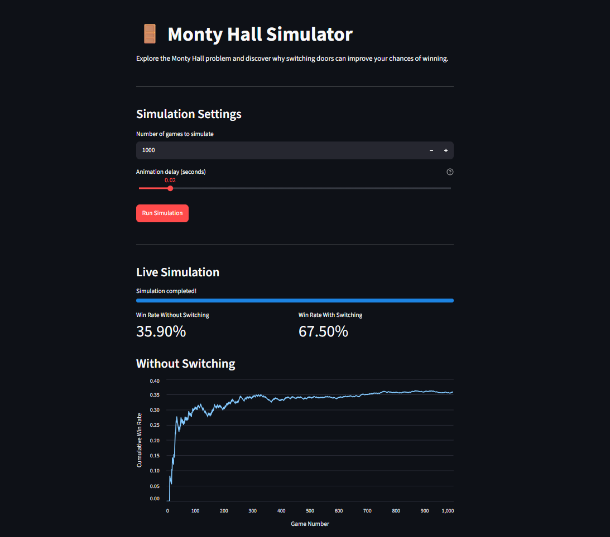

# Monty Hall Problem

A Python simulation of the Monty Hall problem that compares the winning probabilities of staying with the initial door choice versus switching to the other unopened door. The project includes both a command-line simulation and an interactive Streamlit web interface with live charts.

## About the Project

The Monty Hall problem is a probability puzzle inspired by a game show scenario.

There are three doors:

- One door hides a car.
- Two doors hide goats.

The player chooses one door. The host, who knows what is behind each door, opens another door hiding a goat. The player can then either keep the original choice or switch to the remaining unopened door.

Although switching may feel counterintuitive, it improves the probability of winning:

- **Stay with the initial choice:** approximately 1/3 probability of winning.
- **Switch to the other unopened door:** approximately 2/3 probability of winning.

This project simulates the game repeatedly to compare both strategies experimentally.

## Application Preview

The project includes an interactive web interface built with Streamlit. Users can configure the number of games, adjust the animation speed, and observe win rates and charts as the simulation progresses.

<!-- Add a screenshot of the Streamlit application at assets/monty-hall-simulator.png -->


## Features

- Simulates individual Monty Hall games.
- Compares staying and switching strategies.
- Runs multiple simulations and calculates cumulative win rates.
- Provides an interactive Streamlit web interface.
- Allows users to configure the number of games to simulate.
- Includes adjustable animation delay.
- Displays live win-rate metrics and charts during simulation.
- Validates simulation input.
- Includes automated tests using `pytest`.
- Uses `unittest.mock.patch` to test game logic under controlled conditions.
- Separates simulation logic from the user interface.

## Project Structure

```text
Monty Hall Problem/
├── README.md
├── .gitignore
├── src/
│   ├── app.py
│   └── main.py
├── tests/
│   └── test_monty_hall.py
└── assets/
    └── monty-hall-simulator.png
```

## Requirements

- Python 3.12 or a compatible Python version
- Streamlit
- Pandas
- pytest (for running tests)

## Installation

Clone the repository and navigate to the project directory:

```bash
git clone https://github.com/saeedrostami-dev/monty-hall-problem.git
cd monty-hall-problem
```

Create and activate a virtual environment if desired, then install the dependencies:

```bash
python -m pip install streamlit pandas pytest
```

## Run the Command-Line Simulation

From the project root directory, run:

```bash
python src/main.py
```

The program simulates 1,000 games for each strategy and prints the resulting win rates.

Example output:

```text
Number of games: 1000
Win rate without switching: 33.20%
Win rate with switching: 66.80%
```

*The results are random and will vary between runs.*

## Run the Streamlit Application

From the project root directory, run:

```bash
streamlit run src/app.py
```

Streamlit will provide a local URL in the terminal. Open that URL in your browser to use the application.

You can:

1. Choose the number of games to simulate.
2. Adjust the animation delay.
3. Start the simulation.
4. Observe the win-rate metrics and charts as the simulation progresses.

## Run the Tests

Run the test suite from the project root directory:

```bash
python -m pytest -v
```

The tests cover input validation, simulation behavior, and the main win/loss scenarios for staying and switching.

## Concepts Practiced

- Python functions and return values
- Type hints
- Lists and list comprehensions
- `enumerate()`, `next()`, and generator expressions
- Randomization with the `random` module
- Input validation and exceptions
- Cumulative calculations and win rates
- Data visualization with Pandas and Streamlit
- Interactive UI components and progress indicators
- `pytest` and parameterized tests
- Mocking with `unittest.mock.patch`
- Separating application logic from the user interface
- Git and GitHub project workflow

## Future Improvements

- Add an interactive mode where users can play individual rounds.
- Display the theoretical probabilities alongside simulation results.
- Add options to compare multiple simulation runs.
- Improve the visualization and application layout.

## License

This project is intended for learning and practice.
